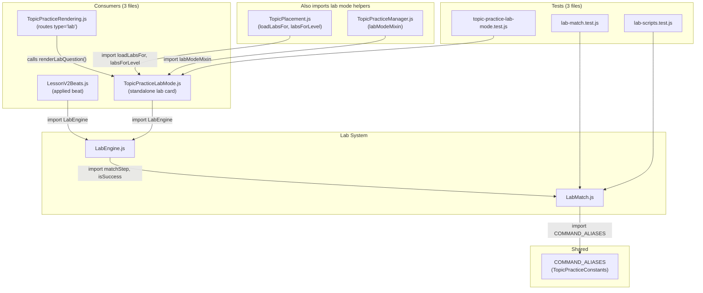

# Full Review: LabEngine.js & LabMatch.js

## What These Files Do Today

### [LabMatch.js](file:///c:/Users/Renan Macena/Desktop/WORK/security-teacher/js/topics/lab/LabMatch.js) — Pure validation logic (100 lines)

A **zero-DOM, zero-side-effect** module that does one thing: check whether a user-typed CLI command matches a lab step's expected answer. It supports:

- **Exact match** with normalization (lowercase, whitespace collapse) — [L21-26](file:///c:/Users/Renan Macena/Desktop/WORK/security-teacher/js/topics/lab/LabMatch.js#L21-L26)
- **Flag sorting** so `-la` === `-al` — [L29-31](file:///c:/Users/Renan Macena/Desktop/WORK/security-teacher/js/topics/lab/LabMatch.js#L29-L31)
- **COMMAND_ALIASES** expansion (shared with TopicPracticeManager, BossChallenge, etc.) — [L41-49](file:///c:/Users/Renan Macena/Desktop/WORK/security-teacher/js/topics/lab/LabMatch.js#L41-L49)
- **Regex match** via `acceptRe` — [L70-84](file:///c:/Users/Renan Macena/Desktop/WORK/security-teacher/js/topics/lab/LabMatch.js#L70-L84)
- **Goal-by-state validation** (`isSuccess`) — [L96-100](file:///c:/Users/Renan Macena/Desktop/WORK/security-teacher/js/topics/lab/LabMatch.js#L96-L100)

### [LabEngine.js](file:///c:/Users/Renan Macena/Desktop/WORK/security-teacher/js/topics/lab/LabEngine.js) — Scripted terminal UI (221 lines)

A **state machine** that renders a fake terminal, walks through lab script steps, and validates user input via LabMatch. It owns:

- A step-by-step flow with scrollback history
- 3-stage hint escalation (nudge → partial → full reveal)
- "Never abort" design — wrong answers just increment misses
- Full DOM rendering including terminal chrome, input, and a completion screen

---

## The Dependency Graph



---

## Verdict: **Do NOT Delete — Refactor the Seam**

> [!IMPORTANT]
> These two files are clean, small, well-documented, and well-tested. The problem is not LabEngine/LabMatch themselves — it's that they are a **hardcoded terminal-only exercise format** embedded in the lesson/practice flow, while you are migrating toward **real 2D games via GameHost + KaioEngine**. The fix is to rewire the connection points, not delete the modules.

### Why you shouldn't delete them outright

1. **LabMatch.js is pure logic with zero DOM** — it's trivially reusable by any future game that validates CLI-style commands (your cybersecurity, docker, linux topics will always have command-typing challenges).

2. **14 lab data files** exist under `js/topics/data/labs/` — all hand-authored per topic. Deleting LabEngine means throwing away all that content or rewriting every script into a new format.

3. **3 test files** validate this code — they're passing CI gates. Deleting breaks the pipeline.

4. **The LessonV2 "applied" beat** uses LabEngine as its final practice step. Every cybersecurity lesson ends with a lab. You need a replacement before removing.

---

## What to Change — The Migration Plan

### Phase 1: Make the game system handle labs (the seam)

The key insight from your architecture: **the game registry already has a fallback mechanism.** When `hasGame()` returns false, the system falls through to the legacy path. You need to flip this: make "lab" just another game type that mounts via GameHost.

#### File: [TopicPracticeRendering.js](file:///c:/Users/Renan Macena/Desktop/WORK/security-teacher/js/topics/TopicPracticeRendering.js) — Lines 422-425

```js
// CURRENT: routes directly to LabEngine
case 'lab': {
    this.renderLabQuestion(container, q);
    return;
}
```

**Change to:** Check the game registry first. If a game exists for this topic+level, mount it via GameHost. If not, fall back to the current LabEngine.

#### File: [LessonV2Beats.js](file:///c:/Users/Renan Macena/Desktop/WORK/security-teacher/js/topics/lesson2/LessonV2Beats.js) — Lines 170-186

```js
// CURRENT: directly instantiates LabEngine
async renderApplied() {
    // ...
    this.lab = new LabEngine('topic-lesson-content', {
        onComplete: () => this._advanceBeat(),
    });
    this.lab.load(script);
}
```

**Change to:** Same pattern — check registry, mount game, fall back to LabEngine only when no game is registered for that topic+level.

#### File: [TopicPracticeLabMode.js](file:///c:/Users/Renan Macena/Desktop/WORK/security-teacher/js/topics/TopicPracticeLabMode.js) — Lines 86-93

```js
// CURRENT: directly instantiates LabEngine
renderLabQuestion(container, q) {
    this.lab = new LabEngine('topic-practice-content', {
        onComplete: (summary) => this._finishLab(summary),
    });
    this.lab.load(q.script);
}
```

**Change to:** Same — registry check first, then fallback.

### Phase 2: Keep LabMatch.js as a utility

> [!TIP]
> `LabMatch.js` is a **perfect candidate for reuse** inside your new 2D games. Any game level that involves "type the correct command" (and many of your topics are command-line tools) can import `matchStep()` and `normalizeCmd()` directly. It's already pure and side-effect-free — exactly what game modules in `js/games/parts/` want.

Move it from `js/topics/lab/` to `js/games/parts/` or a shared `js/utils/` location so new game levels can import it without reaching into the topics subsystem.

### Phase 3: Deprecate LabEngine.js (don't delete yet)

Once every topic+level has a registered game, LabEngine becomes dead code. Until then, it's your **fallback safety net** — the same pattern the game registry already uses (§11.2: "Missing registration falls back to legacy lesson engine with notice").

> [!WARNING]
> Deleting LabEngine.js right now would break:
>
> - All 14 topics that have lab data files but no registered game yet
> - The LessonV2 "applied" beat for cybersecurity (and any topic using `lessonv2` layout)
> - The standalone "Lab" practice mode card in TopicPlacement
> - 3 test files in CI

---

## Summary: Exact Lines to Touch

| File                                                                                                                           | Lines   | Action                                                                                  |
| ------------------------------------------------------------------------------------------------------------------------------ | ------- | --------------------------------------------------------------------------------------- |
| [`TopicPracticeRendering.js`](file:///c:/Users/Renan Macena/Desktop/WORK/security-teacher/js/topics/TopicPracticeRendering.js) | 422-425 | Add registry check before `renderLabQuestion()`                                         |
| [`LessonV2Beats.js`](file:///c:/Users/Renan Macena/Desktop/WORK/security-teacher/js/topics/lesson2/LessonV2Beats.js)           | 170-186 | Add registry check before `new LabEngine(...)`                                          |
| [`TopicPracticeLabMode.js`](file:///c:/Users/Renan Macena/Desktop/WORK/security-teacher/js/topics/TopicPracticeLabMode.js)     | 86-93   | Add registry check before `new LabEngine(...)`                                          |
| [`LabMatch.js`](file:///c:/Users/Renan Macena/Desktop/WORK/security-teacher/js/topics/lab/LabMatch.js)                         | —       | **Keep as-is.** Consider moving to shared utils later.                                  |
| [`LabEngine.js`](file:///c:/Users/Renan Macena/Desktop/WORK/security-teacher/js/topics/lab/LabEngine.js)                       | —       | **Keep as fallback.** Deprecate with a comment. Delete only once all topics have games. |
| [`registry.js`](file:///c:/Users/Renan Macena/Desktop/WORK/security-teacher/js/games/registry.js)                              | 23-33   | Add new entries as you build game levels for each topic                                 |

> [!NOTE]
> Your existing `HOW_TO_ADD_NEW_GAMES.md` already documents the exact workflow: create the level file, register it in `registry.js`, add to `sw.js`. The lab system doesn't need to change — you just need to **intercept** the 3 call sites above so they check the registry before falling back to LabEngine.
